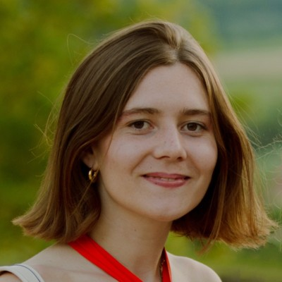
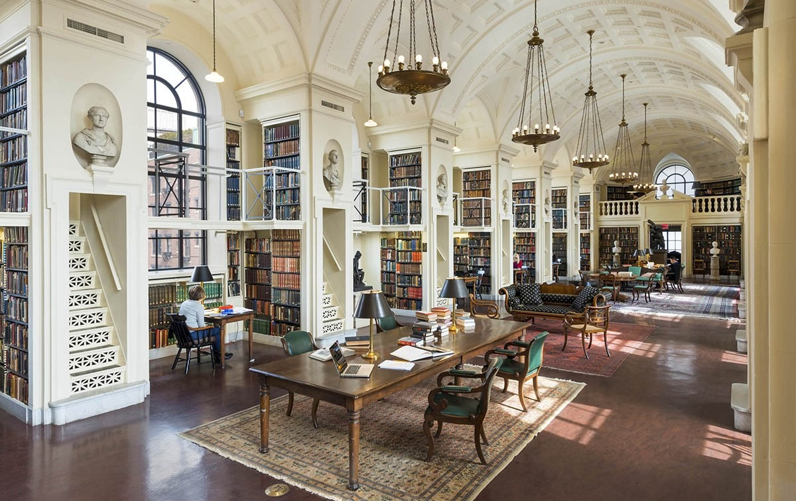
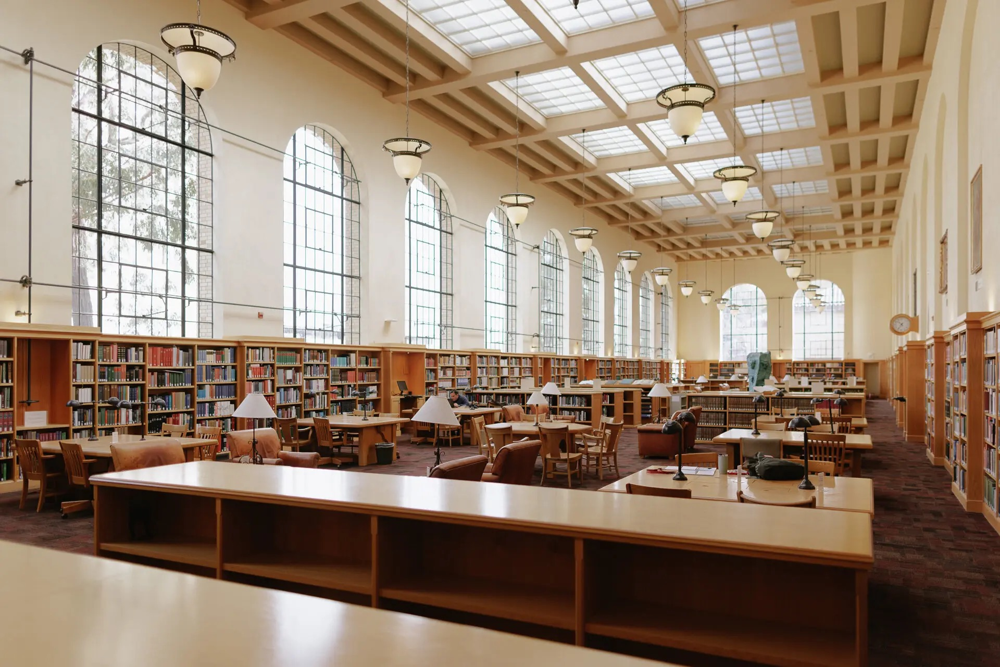
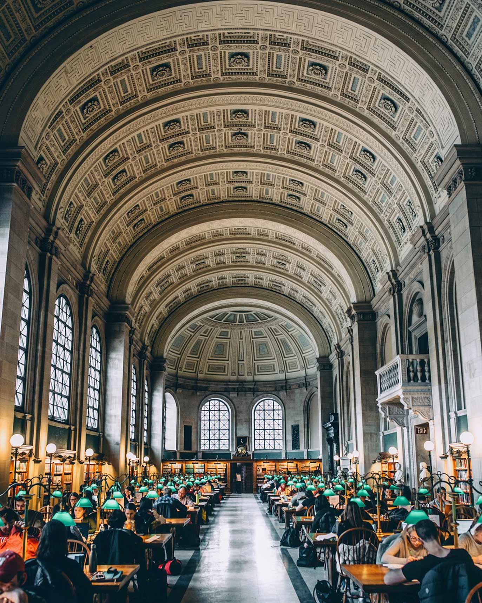

  

    
    

      
Links ↓

      

        <a class="icon linkedin" href="https://www.linkedin.com/in/philippine-burdeau/" aria-label="LinkedIn" target="_blank" rel="noopener" title="LinkedIn">LinkedIn</a>
        <a class="icon github" href="https://github.com/pburdeau" aria-label="GitHub" target="_blank" rel="noopener" title="GitHub">GitHub</a>
        <a class="icon scholar" href="https://scholar.google.com/citations?user=sJb11sYAAAAJ&hl=fr" aria-label="Google Scholar" target="_blank" rel="noopener" title="Google Scholar">Google Scholar</a>
        <a class="icon email" href="mailto:pburdeau@stanford.edu" aria-label="Email" title="Email">Email</a>
      

    

  

  

    
Key Topics

    <ul class="big-bullets">
      <li>Climate tech and industrial decarbonization</li>
      <li>Business development and new markets</li>
      <li>Statistics and ML for emissions</li>
    </ul>
  

Summary

I am <strong>Business Operations Manager</strong> at <a href="https://www.dioxycle.com/" target="_blank" rel="noopener"><em>Dioxycle</em></a>, a climate tech startup based in Paris and the Bay Area. I work on new business opportunities, bridge technical and commercial teams in business development, and support business operations and intellectual property.

<strong>Background:</strong> <a href="https://programmes.polytechnique.edu/en/ingenieur-polytechnicien-program/ingenieur-polytechnicien-program" target="_blank" rel="noopener">Applied mathematics and physics at <em>École Polytechnique</em></a> (France) • <a href="https://www.unibocconi.it/en/programs/master-science/politics-and-policy-analysis" target="_blank" rel="noopener">MSc in Politics & Policy Analysis at <em>Bocconi University</em></a> (Italy) • PhD in Energy Science & Engineering at <em>Stanford University</em> (2026), with Prof. Adam Brandt in the <a href="https://eao.stanford.edu/" target="_blank" rel="noopener">Environmental Assessment & Optimization</a> group • Prior experience in public policy (France Stratégie) and strategy consulting (Kearney)

<strong>Research:</strong> During my PhD, I developed statistical and machine learning methods to reduce uncertainties in methane emissions estimates, including a <a href="/research#gas-composition">high-resolution map of U.S. natural gas composition</a>, <a href="/research#statistical-inference">statistical methods for intermittent emissions</a>, and <a href="/research#technology-evaluation">controlled release experiments</a> evaluating methane detection technologies. I also helped organize the <a href="https://www.youtube.com/c/MethaneEmissionsTechnologyAlliance" target="_blank" rel="noopener">Methane Technology Alliance</a> seminar series.

<strong>Publications:</strong> My work has been published in <em>Nature Communications</em>, <em>Environmental Science & Technology</em>, <em>Atmospheric Measurement Techniques</em>, and <em>ACS ES&T Air</em>. See my <a href="/publications/">full publication list</a>.

<strong>How I work:</strong> I'm idealistic, empathetic, and driven. I like to understand problems as a whole and then fix them, which is what has drawn me to climate change from several angles: policy, consulting, research, and now industry.

Work Nooks

  <figure class="nook">
    
    <figcaption>Boston Athenæum<small>quiet, books, daylight</small></figcaption>
  </figure>
  <figure class="nook">
    
    <figcaption>Green Library (Stanford)<small>campus calm</small></figcaption>
  </figure>
  <figure class="nook">
    
    <figcaption>Boston Public Library<small>grand tables</small></figcaption>
  </figure>

Personal

I'm French, 28 years old, married to <a href="https://axlevy.com/" target="_blank" rel="noopener">Axel Levy</a> (also French) since August 2024. We met in New Caledonia during our military service.

Outside of work, I spend time playing piano, writing, running, and by the ocean when I can.

